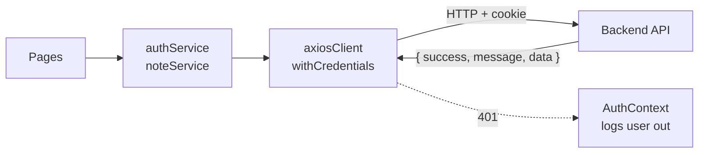

<div align="center">

# Notes · Frontend

**React client for a full-stack note-taking app with secure, private notes for every user.**


**[Live app](https://infrasity-assignment-dev.vercel.app)** · **[Frontend repo](https://github.com/Aman-kumar-git12/InfrasityAssignmentDev)** · **[Backend repo](https://github.com/Aman-kumar-git12/InfrasityAssignmentBackend)**

[Features](#features) · [How it works](#how-it-works) · [Getting started](#getting-started) · [Routes](#routes) · [Deployment](#deployment) · [Structure](#project-structure)

</div>

---

## About

**Notes** is a simple, private note-taking web app. You create an account, log in, and keep your own notes: write a new note, read it later, edit it, or delete it. Every note belongs to the person who wrote it, and nobody else can see or change it.

The project has two parts:

- **Frontend (this repo):** the website you use, built with React. It has the login and sign-up pages, your list of saved notes, and pages to write, read and edit a note.
- **Backend:** the server behind it, built with Node.js and Express. It handles accounts and stores the notes in a MongoDB database.

## Repositories

| Part | Repository | Hosted on |
| --- | --- | --- |
| **Frontend** (React + Vite) · *you are here* | [Aman-kumar-git12/InfrasityAssignmentDev](https://github.com/Aman-kumar-git12/InfrasityAssignmentDev) | [Vercel](https://infrasity-assignment-dev.vercel.app) |
| **Backend** (Express + MongoDB) | [Aman-kumar-git12/InfrasityAssignmentBackend](https://github.com/Aman-kumar-git12/InfrasityAssignmentBackend) | [Render](https://infrasityassignmentbackend.onrender.com/api/health) |

## Features

- **Auth:** sign up, log in and log out; the session lives in an **httpOnly cookie** set by the API
- **Notes:** create, view, edit and delete, each on its own URL
- **Protected routes:** logged-out users are sent to `/login`, logged-in users skip the auth pages
- **Safe delete:** a confirmation dialog appears before anything is removed
- **Backend-driven messages:** every success and error message in the UI comes from the API
- **Clean UI:** dark green-black theme, hamburger sidebar, responsive, plain CSS

## How it works



- **`axiosClient`** sends every request to `${VITE_BACKEND_URL}/api` with the cookie, unwraps `res.data`, and turns errors into `{ status, message }`.
- **`AuthContext`** loads the current user on startup (`/auth/me`) and logs out automatically when the session expires (any `401`).
- **`ProtectedRoute` / `PublicRoute`** guard pages based on that user.

## Getting started

**Prerequisites:** Node.js 20.19+ and the [backend](https://github.com/Aman-kumar-git12/InfrasityAssignmentBackend#getting-started) running locally.

```bash
git clone https://github.com/Aman-kumar-git12/InfrasityAssignmentDev.git
cd InfrasityAssignmentDev
npm install
cp .env.example .env      # points at http://localhost:5001
npm run dev               # http://localhost:5173
```

### Environment variables

| Variable | Example | Notes |
| --- | --- | --- |
| `VITE_BACKEND_URL` | `http://localhost:5001` | Backend origin only. **Don't add `/api`**, the client appends it |

`npm run build` fails on purpose if `VITE_BACKEND_URL` is missing, so a broken build never ships.

## Routes

| Route | Page |
| --- | --- |
| `/login`, `/signup` | Auth pages |
| `/saved` | All your notes, each with **View · Edit · Delete** |
| `/new` | Write a new note |
| `/saved/:id/viewonly` | Read a note |
| `/saved/:id/edit` | Edit a note |
| anything else | 404 page |

## Deployment

Deployed on **Vercel** (framework preset: Vite).

| Setting | Value |
| --- | --- |
| Build command | `npm run build` |
| Output directory | `dist` |
| `VITE_BACKEND_URL` | `https://infrasityassignmentbackend.onrender.com` |

Set `VITE_BACKEND_URL` under *Settings → Environment Variables*, then redeploy. Vite bakes it in at build time. [`vercel.json`](vercel.json) rewrites every path to `index.html`, so deep links like `/saved/123/edit` work on refresh.

The backend's `CLIENT_URL` must match this site's URL exactly, or the browser will block requests (CORS).

## Project structure

```
src
├── api/            axiosClient
├── components/     NotesLayout, Navbar, Sidebar, NoteForm, NoteCard, ConfirmDialog, Alert, Loader, route guards
├── context/        AuthContext
├── hooks/          useAuth, useFlashAlert
├── pages/          Login, Signup, SavedNotes, NoteView, NoteEditor, NotFound
├── services/       authService, noteService
├── styles/         index.css
├── App.jsx         route table
└── main.jsx        entry point
```

## Troubleshooting

- **Requests go to `undefined/api`:** `VITE_BACKEND_URL` wasn't set at build time. Set it and redeploy.
- **CORS error:** the backend's `CLIENT_URL` doesn't match the URL you're opening.
- **Logged out right after logging in:** the backend needs `NODE_ENV=production` on Render. Some browsers (Safari, Brave) also block cross-site cookies.
- **First load is slow:** the free Render backend sleeps when idle and takes ~30–60 s to wake.
- **`.env` changes ignored:** restart `npm run dev`.
